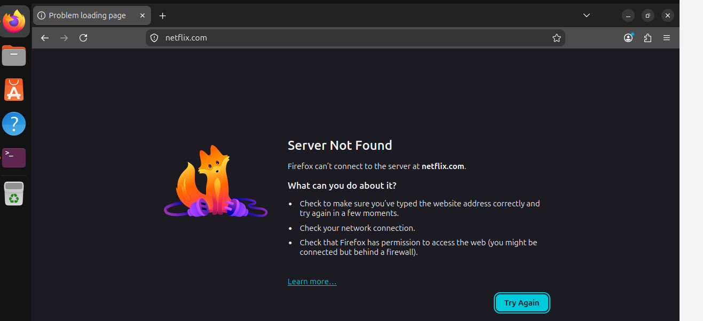
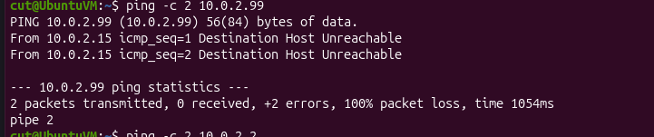
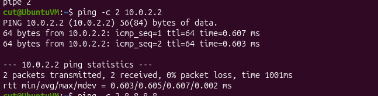
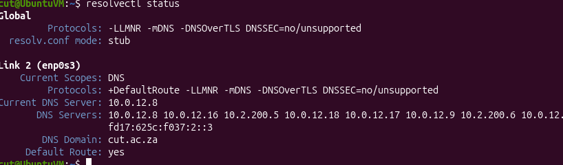

# Linux Network Troubleshooting Lab (Ubuntu)

Hands-on troubleshooting tickets worked on an Ubuntu virtual machine (VirtualBox, NAT network). Each ticket follows the same support workflow: **symptom > hypothesis > tests and evidence > root cause > fix > verification**.

**Skills shown:** first-line network troubleshooting, IP configuration, routing, DNS, reading command output, evidence-based diagnosis, clear ticket documentation.

**Tools used:** `ip a`, `ip r`, `ip route get`, `ip neigh`, `ping`, `resolvectl`, `nmcli`

| Ticket | Issue | Root cause | Status |
|---|---|---|---|
| [1](#ticket-1--websites-load-slowly-then-fail) | Websites time out | Stale static default route pointing at a dead gateway | Fixed and verified |
| [2](#ticket-2--website-name-will-not-resolve) | A site's name will not resolve | DNS server not answering | Diagnosed; fix to be added |

---

## Ticket 1 - Websites load slowly, then fail

### 1. Symptom
Opening `netflix.com` in Firefox resulted in a long wait followed by an error.



### 2. Hypothesis
The page was slow and failing rather than the site being obviously down, so the fault was probably in this machine's network path (address, prefix or route), not the websites. Plan: check local settings first, then test by IP address before testing names.

### 3. Tests and evidence

| # | Question | Command | Result |
|---|---|---|---|
| 1 | Is the interface up with an IPv4 address? | `ip a` | **Pass.** `enp0s3` is UP with `10.0.2.15/24` |
| 2 | Is there a default route, and is the gateway in my subnet? | `ip r` | **Pass, but suspicious.** Two default routes (see below) |
| 3 | Can I reach the gateway `10.0.2.99`? | `ping -c 2 10.0.2.99` | **Fail.** Destination Host Unreachable, 100% loss |
| 4 | Can I reach the internet by IP? | `ping -c 2 8.8.8.8` | **Fail.** Destination Host Unreachable |
| 5 | Can I resolve a name? | `ping -c 2 google.com` | **Fail.** Name or service not known |
| 6 | Can I reach the DHCP gateway `10.0.2.2`? | `ping -c 2 10.0.2.2` | **Pass.** 0% loss, about 0.6 ms |
| 7 | Did anything answer for `10.0.2.99`? | `ip neigh` | `10.0.2.99 ... INCOMPLETE`, so nothing answers. `10.0.2.2` is REACHABLE |
| 8 | Which route is really used for `8.8.8.8`? | `ip route get 8.8.8.8` | `via 10.0.2.99`, the dead gateway |

Evidence of the two default routes:


Gateway `10.0.2.99` does not answer, while `10.0.2.2` does:





Traffic to the internet was sent to the dead gateway:


### 4. Root cause
The machine had **two default routes**:

| Route | Source | Metric | Works? |
|---|---|---|---|
| `default via 10.0.2.99` | static | 20050 | No, nothing answers |
| `default via 10.0.2.2` | DHCP | 20100 | Yes |

Linux prefers the **lower metric**, so all outside traffic went to the dead static gateway and the working DHCP gateway was never used. The interface, IP address and prefix were fine.

### 5. Fix
1. Removed the bad route.

```bash
sudo ip route del default via 10.0.2.99
```

2. Cleared the static gateway and routes from the saved connection profile, so the problem would not return after a reboot, then reactivated the connection:

```bash
sudo nmcli con mod netplan-enp0s3 ipv4.gateway '' ipv4.routes ''
sudo nmcli dev connect enp0s3
```


### 6. Verification
`ip route get 8.8.8.8` now goes via `10.0.2.2`, and `ping -c 2 8.8.8.8` succeeds with 0% packet loss:


### Lessons learned
- Test in order: interface, gateway, internet by IP, then name resolution. Each step narrows the fault.
- `ip route get <address>` shows the route that is *actually* used, which is not always the one you expect.
- A route with a lower metric wins, so one bad route can hide a working one.

---

## Ticket 2 - Website name will not resolve

### 1. Symptom
The CUT website could not be opened in Firefox.

### 2. Hypothesis
Pings by IP address work but names do not resolve, so the network path is intact and the fault is in name resolution. Next step: find which DNS server this machine uses and whether it answers.

### 3. Tests and evidence

| # | Question | Command | Result |
|---|---|---|---|
| 1 | Is there a single, valid default route? | `ip r` | **Pass.** One default route via `10.0.2.2` |
| 2 | Can I resolve a name? | `ping -c 2 google.com` | **Fail.** Name or service not known |
| 3 | Which DNS server am I using? | `resolvectl status` | Current DNS server `10.0.12.8`, which does not answer |




### 4. Root cause
The configured DNS server `10.0.12.8` does not answer queries, so no name can be resolved. Traffic by IP address is unaffected because it never uses DNS.

### 5. Fix
I was going to point the connection at a working DNS server, then reconnect.

### 6. Verification
 re-run `ping -c 2 google.com` and `resolvectl status` and attach the screenshots.
